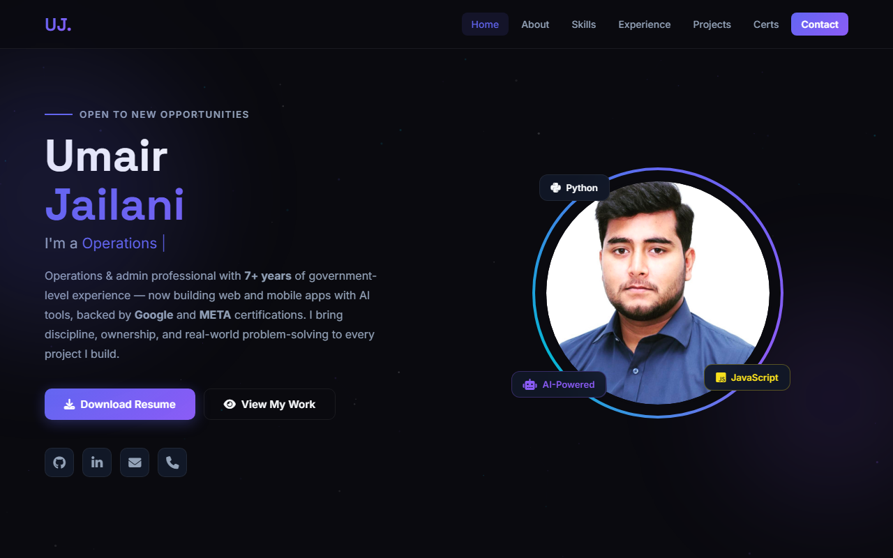

# Umair Jailani · Portfolio

**My personal site: who I am, what I've built, and how to reach me.**

🔗 **[umairjailani.github.io](https://umairjailani.github.io/)** · [Download résumé](https://umairjailani.github.io/Resume.pdf)

## What's on it

| Section | What you'll find |
|---|---|
| **About** | 7+ years in operations and administration at the Federal Ombudsman of Pakistan, and how I moved into building tools with AI |
| **Skills** | Front-end, office and AI tools I work with |
| **Experience** | Case management, legal drafting, hearings and HR records |
| **Projects** | Yaad and the Second Brain first, then web projects with live demos. The web projects load straight from GitHub (any repo tagged `portfolio-project`), so the list stays current without editing the site |
| **Certificates** | Google Project Management, Meta Front-End Developer, Python bootcamp in progress |
| **Contact** | Email, LinkedIn, GitHub and a contact form |

## How it's built

- One `index.html` file: HTML, CSS and vanilla JavaScript, no framework or build step
- Dark theme with smooth scroll and reveal animations, responsive down to phone width
- Projects section fetched live from the GitHub API
- Hosted on GitHub Pages

Built with AI coding tools and maintained by me.

## Run it locally

Open `index.html` in a browser. Fonts, icons and the project list need an internet connection.
